# Chapter 2 · Memory for repeated experience {#repeat}

**Same item, different traces: Dissecting the structure of memory for repeated experience**

Jordan Gunn and Sean Polyn

## Abstract

To investigate the structure of memory for repeated experiences, this study examines how the lag-contiguity effect -- the tendency for items positioned close together in a study list to be retrieved successively during free recall [@kahana1996associative] -- manifests for items with multiple study positions.
Participants will study lists containing both once- and twice-presented items, with the proximity of each presentation of a repeated item to the beginning or end of the study lists varied systematically to probe the influence of serial position effects [@murdock1962serial] on memory trace accessibility.
Using a modified lag-conditional response probability (lag-CRP) analysis, we will compare transition probabilities from repeated items to items studied near either their first or second presentation.
Preliminary analyses across two archival datasets suggest that, even after accounting for serial position effects, the temporal contiguity effect is more pronounced relative to the first presentation of a repeated item than to the second.
Initial results also indicate that the influential Context Maintenance and Retrieval (CMR) model [@polyn2009context] may not accurately predict these differences, pointing to potential limitations in its current framework.
Further data collection, follow-up analyses, and proposed modeling aim to clarify these findings, enhancing our understanding of memory search and refining theoretical models of memory for repeated experiences.

## Introduction

What is the structure of memory for repeated experience?
It's a basic law of memory that repeated study of a piece of information usually improves our memory for it [@kahana2022laws].
Yet, from the pioneering work of Ebbinghaus [@ebbinghaus1885memory] onwards, researchers have understood that the mechanisms behind this improvement are complex—not simply a matter of strengthening the original memory trace [@delaney2010spacing]. 
A particularly well-documented factor behind the benefits of repetition is the spacing between study events.
Studies across various conditions and materials consistently show that spaced repetitions -- where intervals between restudy are longer -- tend to enhance memory more significantly than when repetitions are grouped together [@cepeda2006distributed].
Several theories attempt to explain this spacing effect, focusing on factors like effort, variability in encoding, rehearsal strategies, and retrieval dynamics. 
However, no single explanation has emerged as definitively superior [@maddox2016understanding].
Moreover, repetition doesn't only enhance the memorability of information; it also affects how memories are organized and retrieved in sequences, such as in free recall tasks.
This highlights the need for more nuanced theories that can explain how repetitions influence the structural organization of memory retrieval.

A promising framework for understanding the structure of memory for repeated experience is the Context Maintenance and Retrieval (CMR) model [@polyn2009context], a leading computational implementation of the retrieved context theory (RCT) of free recall.
RCT posits that each item studied is linked in memory with a continuously updated, recency-weighted context representation, which later guides the retrieval process during free recall as the primary retrieval cue.
The CMR model has successfully explained various repetition effects and recall phenomena, including the spacing effect [@lohnas2014retrieved; @lohnas2024temporal], as well as broader patterns in free recall such as the serial position effect and lag-contiguity effect [@polyn2009context]. 
By modeling the iterative processes of memory search, CMR offers a comprehensive view of how prior experiences influence ongoing encoding and retrieval across different experimental conditions.

While CMR represents a substantial advance in computational modeling of key phenomena, existing evaluations of the CMR model as an account of repetition effects have so far been limited in scope.
While the model has been successful in qualitative simulation of key repetition effects, it has yet to receive formal evaluation for its ability to predict entire responses sequences in free recall for lists with repeated items.
Existing analyses have focused primarily on the model's predictions regarding study-phase retrieval and the spacing effect, potentially overlooking other critical aspects of repetition in free recall. 
These gaps raise questions about whether CMR provides a complete account of repetition effects or requires further refinement.

The present work aims to address these gaps in our understanding of repetition effects in memory by combining more robust model evaluation with a new experiment and analyses that more finely dissect the distinct consequences of each presentation of a repeated item for the temporal organization of memory search.
Participants in this study will be presented with lists containing items shown either once or twice.
For items appearing twice, we'll manipulate their presentation positions to probe their distinct memory contributions.
Some items will appear first near the start and again around the middle of the list.
Others will appear first near the middle and again near the end.
This design leverages the well-established finding that items at the beginning and end of a list are typically remembered better [@murdock1962serial].
By varying the positions of repeated items, we aim to isolate and examine the unique memory contributions of each occurrence by manipulating the strength of their associated memory traces.

To interpret the results of this manipulation, I propose novel analyses that identify the independent effects of each study event of a repeated item on free recall task performance.
The key analysis will focus on the temporal contiguity effect—the tendency for sequentially proximate items in a study list to be recalled in close sequence [@kahana1996associative].
Using a modified version of the lag-conditional response probability (Lag-CRP) analysis, we will measure transition rates from recalls of twice-presented items to neighbors of either their initial or subsequent presentation positions, reflecting the reinstatement of context associated with each presentation of a repeated item.
This analysis approach allows us to quantify how the contextual features associated with each presentation of a repeated item individually shape the memory search process.
And to extend prior evaluations of the CMR model, I propose to apply the likelihood-based model comparison [@kragel2015neural], generalization criterion [@busemeyer2000model] and related techniques to evaluate the model's ability to account for these results and examine alternatives that address its limitations.
Developing and evaluating computational models designed to account for these effects will help refine our understanding of the structure of memory for repeated experience.

## Theoretical Framework

::: {#fig-repeat-cmr}
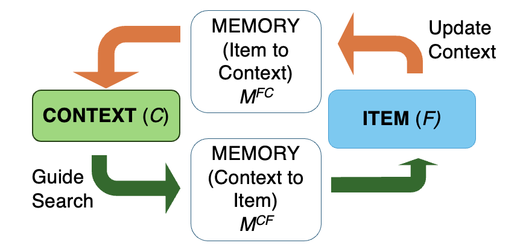

**The Context Maintenance and Retrieval (CMR) model**. The model posits that each item studied is associated with a continuously updated, recency-weighted context representation. During free recall, the current state of the context vector acts as the primary retrieval cue, guiding memory search through the sequence of studied items. The model's mechanisms of contextual evolution and reinstatement enable it to account for key repetition effects and recall phenomena in free recall tasks.
:::

The present research emphasizes the free recall task because it offers a unique blend of experimental control and behavioral richness that has made it a powerful tool for studying the structure of memory [@howard2002distributed].
In the task, participants study a sequence of items and then are asked to recall as many of the items as they can, in any order they choose.
This ordering has provided insights into the underlying processes and representations that guide memory search, enabling accounts of repetition and other effects that go beyond item memorability measures to explain the sequential organization of recall.
And the straightforward study-test structure of the task has allowed researchers to precisely manipulate which items are studied and when, achieving fine-grained control over the memories encoded and their relationship to one another.
Notably, spacing effects -- the most evident among repetition phenomena -- are especially pronounced in free recall, highlighting its utility for investigating how repetition influences memory [@cepeda2006distributed].

Theoretical interpretations of free recall conceive it as a dynamic search through memory, where each retrieval act updates the cue for the next, essentially guiding navigation through a mental timeline of events [@tulving1972episodic].
A converging body of work suggests that the Context Maintenance and Retrieval model [CMR\; @polyn2009context] can simultaneously account for basic features of memory search and key repetition effects in free recall [@lohnas2014retrieved; @lohnas2024temporal].
Rooted in the retrieved context theory (RCT) of free recall, CMR elaborates on how interactions between item-context associations and context-driven retrieval processes manifest repetition effects and other recall phenomena.

Central to the CMR model is the concept of temporal context, envisioned as a vector of features that evolves over time, reflecting a recency-weighted average of past experiences.
When an item is studied, it becomes associated with the current state of the temporal context vector.
This linkage is bidirectional: the context not only cues the item but also updates itself with the item's associated contextual features in a process of context reinstatement.
For items appearing the first time in a list, the reinstated context derives from pre-experimental experiences—contexts tied to earlier occurrences of the item outside the ongoing trial.
For items appearing a second time, the reinstated context blends pre-experimental contexts with those linked to the item's first appearance.
This reinstated context partially modifies the existing context vector, maintaining some influence from earlier encoding events.
This residual effect facilitates the associative linkage between temporally adjacent items, enabling the retrieval of one item to cue the next ones close in the sequence.

During free recall, the current state of the temporal context vector acts as the retrieval cue.
Items strongly associated with the current context are more likely to be recalled.
Following the retrieval of an item, its associated context is reinstated, mirroring the encoding phase.
This reinstatement updates the temporal context vector, configuring subsequent retrieval attempts.
This iterative process of context-driven retrieval and updating continues until no more items are recalled, producing an interplay of memory encoding, retrieval, and updating that shapes how we remember sequences of events.

### The Temporal Organization of Free Recall

::: {#fig-repeat-temporal-organization layout="[[1, 1]]"}
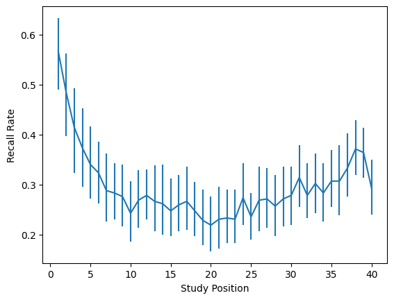{#fig-repeat-serial-position-curve}

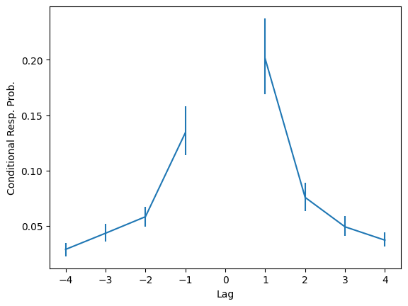{#fig-repeat-lag-crp}

**The temporal organization of free recall**. Example analysis outcomes using control lists from @lohnas2014retrieved (no item repetitions). The U-shaped serial position curve reflects the combined influence of the primacy and recency effects on recall performance. The lag-CRP analysis identifies an assymetric lag-contiguity effect, where participants are more likely to transition to items studied near the serial position of the last recalled item, especially in forward transitions.
:::

The emphasis here on the retrieved context account of memory search stems from the theory's ability to account for key features of the temporal organization of free recall.
The Context Maintenance and Retrieval (CMR) model provides a formal generative account of the temporal organization of the course of memory search in the free recall task, explaining not just differences in recall rates between items, but also predicting the structure of recall sequences themselves.
CMR addresses three particularly robust benchmark phenomena in the free recall task: the primacy effect, the recency effect, and the lag-contiguity effect.

Primacy and recency effects in free recall compose the well-established serial position effect that has been used to argue for the importance of temporal organization in memory search [@murdock1962serial].
The primacy effect refers to the enhanced recall of items at the beginning of a list, attributed to increased attention or rehearsal at the start of learning.
The recency effect, conversely, pertains to the improved recall of the most recently studied items, driven by their fresher mental representations.
The two are most commonly measured by the serial position curve, which plots the probability of recall for each item in a study list as a function of its serial position in the list.
The U-shaped curve that typically results from this analysis reflects the combined influence of the primacy and recency effects on recall performance (@fig-repeat-serial-position-curve).
Analysis also extends to how often recall initiates with each item, providing insights into how the position affects the likelihood of an item starting the recall sequence.
Across both analyses, the boost in recall performance for items from the beginning of the list is called the primacy effect.
The boost in recall for items from the end of the list is called the recency effect: more recently studied items are more likely to be recalled than items studied earlier.

The CMR model explains the recency effect by the similarity between the current contextual state during recall and the context associated with recently studied items.
In scenarios where there's a delay filled with distractions between the study phase and recall (delayed free recall), the recency effect tends to diminish over time as the contextual link degrades, allowing primacy effects to emerge more strongly.
To explain the primacy effect, CMR posits two main mechanisms.
The first is superior encoding: early items in a study list are hypothesized to be encoded more strongly due to heightened attention or active rehearsal at the beginning of the learning session [@sederberg2008context].
This leads to robust associations between these items and their corresponding contextual states, enhancing their retrievability.
The second is context reinstatement: at the start of the recall phase, there is an intentional partial reinstatement of the context from the beginning of the list, priming the recall of items in those early study positions [@polyn2009context].
This strategic retrieval of initial contextual states facilitates the recall of early items, and has been shown to even facilitate performance on the free recall task overall [@zhang2022optimal].
The influence of these mechanisms on recall performance varies depending on several factors, including the length of the study list and any intervening delays between study and recall.
These dynamics are robustly modeled by CMR, which has been shown to align well with empirical data under a variety of conditions.

The lag-contiguity effect refers to the tendency during free recall to transition to items that were studied near the serial position of the last recalled item.
It is arguably the most pivotal empirical constraint for accounts of the temporal dynamics of memory search in the free recall task [@howard2002distributed; @polyn2009context; @kahana2020computational].
The effect is measured using the lag-conditional response probability (lag-CRP).
In this analysis, each transition in a recall sequence is classified by the number of intervening items, or "serial lag," between the currently recalled item and the next.
The lag-CRP quantifies the likelihood of transitioning to an item at a specific lag, provided that such a transition is possible -- that is, the target item was studied and has not yet been recalled (@fig-repeat-lag-crp).

This analysis has revealed that participants consistently show a preference for transitioning to temporally adjacent items.
But while this clustering is bidirectional, the effect is asymmetric: forward transitions (e.g., from item 5 to item 6) are more common than backward transitions (e.g., from item 2 to item 1).
The lag-contiguity effect substantially constrains the ways theories of free recall can explain not just differences in recall rates between items, but also the structure of item-to-item transitions in recall sequences.

The Context Maintenance and Retrieval (CMR) model explains the lag-contiguity effect through its mechanisms of temporal context management and retrieval cueing.
In CMR, the context associated with each studied item carries forward traces of earlier contexts, making it more similar to contexts of temporally adjacent items.
This similarity decreases with increasing lag between items.
Moreover, the structure of these contextual associations is asymmetric.
Normally, the context for an item is absent until its point of study but continues to influence the encoding of subsequent items, making forward-going (positive lag) transitions more likely than backward-going (negative lag) ones.
Thus, when an item is recalled, the reinstated context closely aligns with that of following items rather than preceding ones, leading to a predominance of forward transitions and an assymetric lag-contiguity effect.

### Repetition Effects in Free Recall

::: {#fig-repeat-repeitition-schematic}

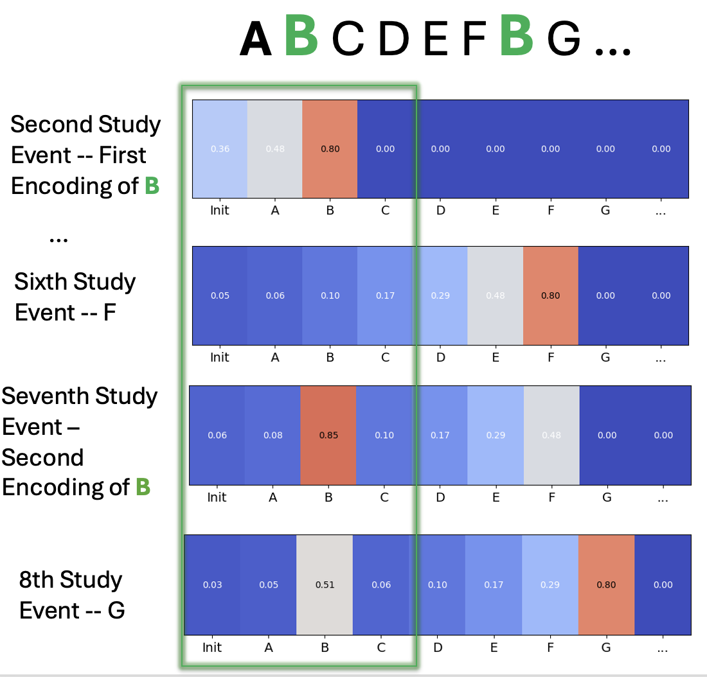{width=300}

**CMR's contextual states when encoding a study list featuring an item repetition.**
CMR implements two hypotheses explaining repetition effects in free recall. 
According to the *contextual variability hypothesis*, repeating an item in spaced study positions correspondingly associates the item with distinct contextual states, enhancing its accessibility during recall by allowing for more cues to prompt retrieval.
According to the *study-phase retrieval hypothesis*, when an item is encoded for the second time, the context associated with its first presentation is reinstated, elaborating on the initial encoding and enhancing the item's accessibility during recall.
:::

From its inception, the Context Maintenance and Retrieval (CMR) model has addressed the role of prior experience in shaping memory search, particularly prior study lists and semantic associations [@polyn2009context].
More recently, research has explored how the model uses similar mechanisms to account for within-list interactions between items, particularly those that are repeated during study [@lohnas2014retrieved].
This research has helped to clarify how the model's mechanisms of context reinstatement and study-phase retrieval interact to produce repetition effects in free recall.

The spacing effect is classically understood as a repetition effect, and has been a central focus of research on memory for repeated experience [@cepeda2006distributed]
However, it applies even to pairs of distinct items, not just repeated items.
By measuring the probability of retrieving either of two study items during a free recall trial -- an analysis termed the "OR score" -- research consistently finds that pairs of spaced items were more likely to be recalled than pairs of massed items [@lohnas2011contextual].
Notably, in a phenomenon called "superadditivity", the mnenomic benefit of spacing tends to be more pronounced for repeated items than for distinct items .
The probability of recalling an item repeated in a spaced fashion is higher than the probability of recalling one of two distinct but similarly spaced items, violating statistical independence [@benjamin2010makes].
This has been interpreted as evidence that additional mechanisms are at play when items are repeated, beyond those that govern the spacing effect for distinct items.

CMR's mechanisms implement two influential hypotheses that have been advanced to explain these features of the spacing effect: encoding variability and study-phase retrieval [@lohnas2014retrieved].
Encoding variability posits that the more distinct the contexts associated with each presentation of an item, the more cues are available to prompt retrieval of the item, increasing the probability of recall [@bower1972coding].
CMR implements this account because it posits that the state of temporal context evolves with each encoding event in a sequence memory experiment and then associates with the item studied at that time.
In addition, the model's context reinstatement mechanisms enact a form of study-phase retrieval, where the context associated with an item's first presentation is reinstated at its second presentation, elaborating on the initial encoding [@greene1989spacing; @lohnas2014retrieved; @maddox2016understanding].
This mechanism is perhaps particularly relevant for addressing the superadditivity of item repetition, as it suggests that memory traces from items' initial and subsequent presentations interact during encoding to enhance the item's accessibility during recall.

@lohnas2014retrieved's major contribution was to simulate and measure key predictions CMR makes about the structure of memory for repeated experience as a consequence of these mechanisms.
Using parameters fitted to a previous dataset, they simulated free recall of study lists following one of four conditions, comparing the model's performance to that of human participants.
Within each session, subjects encountered three lists of each of four types.
Pure control lists contained all once-presented items and provided baseline recall performance measures for comparison against the other conditions.
Pure massed lists contained all twice-presented items, while pure spaced lists contained items presented twice at lags 1-8.
Finally, mixed lists contained a mix of once-presented, massed, and spaced items, allowing for examination of repetition effects in the free recall task.

The results of the study were consistent with CMR's predictions.
Both the data and CMR reproduced a monotonic increase in recall probability with increasing spacing between repeated items, a hallmark of the spacing effect.
Similarly, OR score analyses revealed across applicable conditions that pairs of spaced items were more likely to be recalled than pairs of massed items.
And while superadditivity was not directly examined, the spacing effect was more pronounced for repeated items than for distinct items in both data and model simulations, consistent with the phenomenon.

::: {#fig-repeat-neighbor-contiguity layout="[[1, 1]]"}

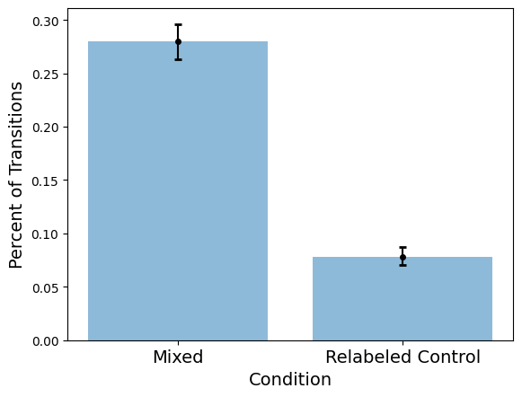

**The repetition neighbor contiguity analysis**. CMR predicts that the context associated with the first presentation of a repeated item is reinstated at the second presentation, associating neighbors of the two presentations. To test this prediction, @lohnas2014retrieved measured the probability of transitioning from a +1 or +2 neighbor of the first presentation of a repeated item to a +1 or +2 neighbor of the second presentation of the item and vice versa. To control for serial position effects, they used data from control lists (no item repetitions) with study positions matched to shufflings of mixed lists to establish a baseline rate of these transitions.
:::

@lohnas2014retrieved also examined CMR's assertion that studying an item for a second time retrieves and reinstates into context the contextual features associated with its first presentation (@fig-repeat-neighbor-contiguity).
@lohnas2014retrieved identified a potential consequence of this mechanism: since the context from an item's first presentation is reinstated at its second presentation, the contextual states associated with items studied successively to each presentation should be particularly similar, compared to if the study events were unrelated.
This increased similarity should in turn lead to heightened rates of transitions from neighbors of the first presentation of a repeated item to neighbors of the second presentation of the item -- even if the repeated item itself is not recalled.
To test this prediction, in what we will call a "neighbor contiguity analysis", @lohnas2014retrieved measured the probability of transitioning from a +1 or +2 neighbor of the first presentation of a repeated item to a +1 or +2 neighbor of the second presentation of the item and vice versa across repeated items in experimental data.
They used data from control lists (no item repetitions) to establish a baseline rate of these transitions, matching study positions used for the analyses to control for serial position effects.
Model simulations and participant data were both consistent with this prediction, finding a robust boost in transition rates between repetition neighbors relative to control lists.
These results together substantially burnished CMR and retrieved-context theory as accounts of repetition effects in free recall.

### Motivation for New Experiment

::: {#fig-repeat-rep-crp-base layout="[[1, 1]]"}

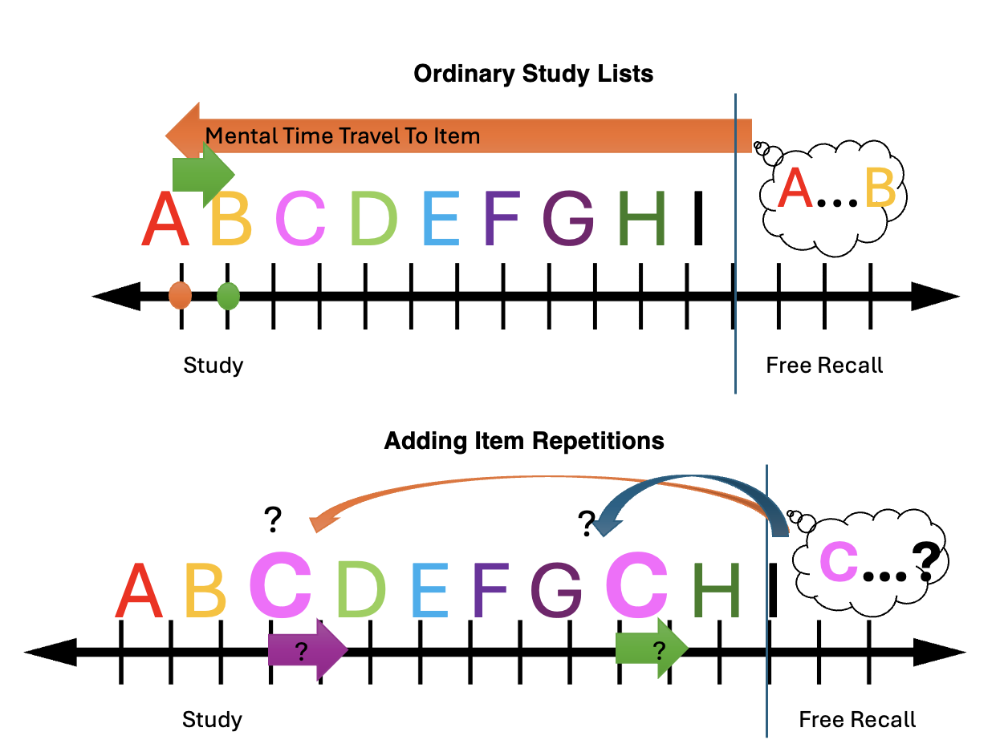

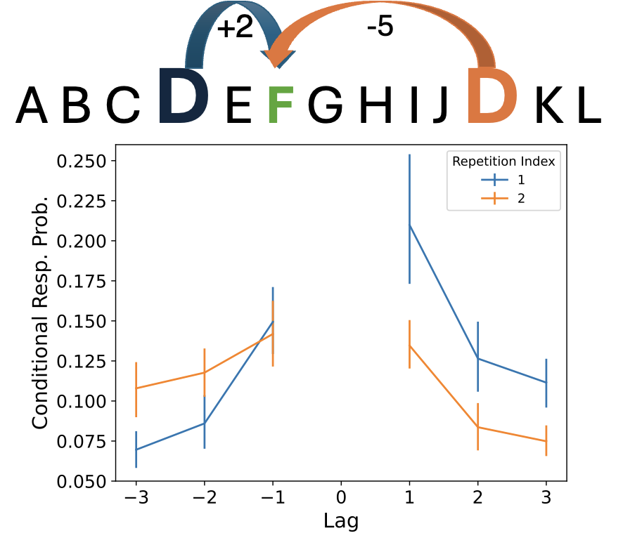

**The repetition Lag-CRP analysis**. **A.** The lag-contiguity effect has informed a conceptualization of memory search in the free recall task as a traversal over a mental timeline of events, with transitions between items reflecting the temporal proximity of their study positions.
However, this notion is disrupted when considering transitions from items with multiple study positions, which have multiple positions on a hypothetical mental timeline.
**B.** To investigate the structure of memory for repeated experience, we propose a novel analysis that extends the lag-CRP to repeated items, measuring the probability of transitioning to items at each lag relative to the first and second presentations of repeated items.
A comparison of these transition probabilities identifies a differential repetition contiguity effect, where transitions to neighbors of the first presentation of a repeated item are more likely than to neighbors of the second presentation.
Figure generated using data from mixed list condition of @lohnas2014retrieved.
:::

The lag-CRP analysis played a key role in the advancement of models of free recall by providing a detailed quantitative measure of the temporal structure of memory for word lists that substantially constrained potential generative accounts of memory search in free recall [@howard2002distributed; @polyn2009context; @kahana2020computational].
Recent work in the study of repetition has similarly shifted emphasis from characterizing changes in recall likelihood to understanding how item repetition affects the course of memory search in free recall tasks [@lohnas2014retrieved].
The proposed research will build on this work by applying the lag-CRP analysis to repeated items in free recall to measure the probability of transitioning to items at each lag relative to the first and second presentations of repeated items.
This repetition lag-CRP analysis will consider transitions from recalls of repeated items and measure the probability of transitioning to items studied near either presentation of the repeated item.
This and related analyses will provide a detailed characterization of the structure of memory for repeated experience in free recall and help evaluate the ability of the Context Maintenance and Retrieval (CMR) model to account for repetition effects in memory.

Preliminary analyses of trials with item repetitions in archival datasets [@lohnas2014retrieved; @kahana2005spacing] implement the proposed Repetition lag-CRP analysis.
Applying these analyses to the archival datasets, we consistently observe a **differential repetition contiguity effect** (@fig-repeat-rep-crp-base).
Even after accounting for serial position effects, the temporal contiguity effect is more pronounced relative to the first presentation of a repeated item than to the second.
Transition rates to the neighbors of the first presentation of a repeated item are higher than to the neighbors of the second presentation, suggesting that the context associated with the first presentation has a stronger influence on memory search.
Critically, fitting the CMR model to these datasets and simulating the repetition lag-CRP analysis reveals that the model does not accurately predict these differences, pointing to potential limitations in its current framework.

The central manipulation of the proposed experiment is to vary the initial position of the first presentation of repeated items to test the robustness of the repetition contiguity effect with respect to the primacy and recency effects.
The data will prove pivotal for testing the hypothesis that relative differences in the strength of memory traces for repeated items are primarily responsible the repetition contiguity effect, supporting competition between the CMR model and alternative accounts of repetition effects in memory.
Other departures from considered archival datasets -- such as the choice of immediate free recall over delayed free recall and more controlled allocation of repeater study positions -- will help clarify the extent to which results from the archival datasets can be generalized to new experimental conditions.

The proposed research addresses the limitations of prior evaluations of the CMR model by applying a likelihood-based model comparison technique to assess and quantify the model's ability to predict entire response sequences in free recall for lists with repeated items.
This form of model evaluation is more complete than simulation of qualitative patterns as the assessment necessarily penalizes for any systematic discrepancies between the model's predictions and the observed data, even patterns that are not explicitly targeted by the model.
We will also apply the generalization criterion method to evaluate the model's ability to account for data from conditions that were not included in the model fitting process.
This work will represent the first formal application of the generalization criterion method to evaluate CMR and advance our understanding of the model's robustness and generalizability.
Finally, evaluation of alternative models that address the limitations of CMR's current framework will provide a more complete assessment of the mechanisms underlying repetition effects in free recall.

Proposed modeling will focus on adjudicating between three broad hypotheses about the causes of the differential repetition contiguity effect and CMR's difficulty in accounting for it.
A deficient-processing hypothesis suggests that learning events for the initial presentation of repeated items are reliably superior to those for the second presentation, especially under conditions of massed repetition.
This hypothesis posits that the strength of memory traces for repeated items is the primary driver of the repetition contiguity effect, and that a modification of CMR that modifies learning for the second presentation of repeated items could account for the effect.
Compound cueing theory suggests that recalls of repeated items tend to be preceded by recalls of items that were studied near the first presentation of the repeated item, biasing the recall transition toward neighbors of the first presentation of the repeated item.
This account points to a potential deficiency in CMR's ability to account for the data's substantial lag-contiguity effects and suggests that the model may be underpredicting the consistency of compound cueing effects across responses that would create a differential repetition lag-contiguity effect.
Thirdly, a study-phase retrieval hypothesis posits that CMR's account of reinstatement processes enacted upon restudy of repeated items should be modified to better account for the differential repetition contiguity effect.
By enabling reinstatement and relearning of forward-neighbor context states relative to the first presentation of repeated items, a revised mechanism might drive a differential repetition contiguity effect in the model in a way that aligns with the data.
Adjudicating between these variants will involve specifying reasonable implementations, identifying confirmatory or discrepant evidence in the data, and formally comparing the models.

## Proposed Experiment

The proposed experiment manipulates the strength of memory traces for repeated items by varying the study position of the first presentation of repeated items.
When the position of the first presentation of a repeated item occurs in the middle of a study list, the differential repetition contiguity effect may be ameliorated or even reversed due to interaction with the recency effect: transitions to neighbors of the second presentation of a repeated item may be more strongly cued.
By contrast, when the initial position of the first presentation of a repeated item occurs at the beginning of a study list, the differential repetition contiguity effect may be strengthened due to interaction with the primacy effect: transitions to neighbors of the first presentation of a repeated item may be more strongly cued.
The overall experiment will further investigate the reproducibility of the deficient repetition contiguity effect and other results in new data.
This manipulation will allow us to examine the robustness of the repetition contiguity effect and its interaction with other factors that influence the structure of memory for repeated experience and are addressed for by the CMR model.
Such results combined with additional organizational analyses and more robust model comparison techniques will enable full assessment of new potential constraints for models of memory for repeated experience

### Methods

The proposed design is a partial replication and extension of the @lohnas2014retrieved study.
Key deviations from the original design aim to examine the reproducibility of key organizational repetition effects under new conditions and to manipulate the strengths of memory traces associated with repeated items by varying the initial position of the first presentation of repeated items.
The original design included pure massed and pure spaced conditions, which are not examined here.
New manipulations of the mixed list type will be introduced to examine the interaction of the repetition contiguity effect with the primacy and recency effects.

The experiment will involve approximately 35 subjects who will engage in free recall tasks across 24 lists within a 90-minute session.
Word stimuli will be selected from the PEERS word pool, which consists of 1,638 words derived from the University of South Florida free association norms.
To control for semantic relatedness, we will ensure that the GloVe embedding similarity value between any two items does not exceed 0.3.
Within a session, no word will occur in more than one list.
Words will be presented for 2 seconds each, with a 800ms interstimulus interval where a fixation cross will be displayed.
After the study phase, participants will perform immediate free recall of the list, with 60 seconds to recall as many items as possible in any order.
Participants will be encouraged to continue recalling until the time limit is reached.

The study will utilize a within-subjects design, allowing the examination of individual performance across different conditions under time constraints.
To comprise lists, we define two types of items: singletons (items presented only once) and repeaters (items presented twice).
Sessions will contain control lists (containing only singletons) and mixed lists (containing both singletons and repeaters).
Word lists across conditions will be divided into 32 positions, with 20 singletons and 6 repeaters in the mixed lists.
The spacing between repeaters will range from 1 to 6, with equal probability of each lag within a session.
We further classify repeaters into primacy repeaters (initial presentation in one of the first five positions of the list), mid-list repeaters (initial presentation in one of the middle ten positions of the list), and recency repeaters (second presentation in one of the last five positions of the list).
Mixed lists will contain 2 primacy repeaters, 2 mid-list repeaters, and 2 recency repeaters, with applicable positions randomized within each list.

### Archival Datasets

The proposed experiment will be conducted in conjunction with analyses of two archival datasets that have been previously collected and analyzed.

#### @lohnas2014retrieved

Across 4 sessions, 35 subjects performed delayed free recall of 48 lists.
Subjects encountered four different types of lists: 

1. Control lists that contained all once-presented items;
2. pure massed lists containing all twice-presented items; 
3. pure spaced lists consisting of items presented twice at lags 1-8, where lag is defined as the number of intervening items between a repeated item's presentations; 
4. mixed lists consisting of once presented, massed and spaced items.

Within each session, subjects encountered three lists of each of these four types.

In each list there were 40 presentation positions, such that in the control lists each position was occupied by a singleton item, and in the pure massed and pure spaced lists, 20 unique repeater words occupied the 40 positions.
In the mixed lists 28 singletons and six repeater words occupied the 40 positions.
In the pure spaced lists, spacings of repeated items were chosen so that each of the lags 1-8 occurred with equal probability.
In the mixed lists, massed repetitions (lag=0) and spaced repetitions (lags 1-8) were chosen such that each of the 9 lags of 0-8 were used exactly twice within each session.
The order of presentation for the different list types was randomized within each session.

#### @kahana2005spacing

Sixty-six students studied and attempted free recall of 15 different lists of high-frequency nouns drawn from the Toronto Noun Pool [@friendly1982toronto].
The lists consisted of 30 words, each repeated three times for a total of 90 presentations per list.
List presentation was auditory, and the subjects made their responses vocally into a headset microphone.
The words were presented at a rate of 1.5 sec.
After list presentation, the subjects were given a distractor task involving simple arithmetic problems of the form A B C ?.
The subjects had to correctly answer 15 problems in a row before they could proceed to the recall phase.

There were three list types: massed, spaced short, and spaced long.
In the massed lists, each word was repeated three times successively.
In the spaced-short lists, the presentation order was randomized, subject to the constraint that the lag between repetitions was at least 2 and no more than 6.
For the spaced-long lists, presentation order was randomized, subject to the constraint that inter-repetition lags were at least 6 and not more than 20.

### Proposed Analyses

The goal of this project is to characterize the structure of memory for repeated experience and evaluate the ability of the CMR model and plausiable variants to simultaneously account for both key repetition effects and basic benchmark phenomena in free recall across new and archival datasets.
Unless specified otherwise, repetition effects analyses will be conducted separately for each of the three types of repeated items: primacy repeaters, mid-list repeaters, and recency repeaters to enable examination of the impact of serial position on repetition effects.
Piloting of the task will be used to ensure we are seeing substantial primacy and recency effects.

#### Recall Performance

A serial position analysis will characterize recall performance by list position.
Probability of Nth recall analyses will measure the probability of recalling an item at a specified recall position as a function of its serial position in the list.
Primacy and recency effects can also be reflected in this version analysis that focuses on the probability of initiating recall with an item as a function of its serial position.
With respect to repetition effects, we will measure the probability of recall for repeated items as a function of the number of intervening items between their presentations -- the spacing effect.
This analysis will be conducted for each of the three types of repeated items: primacy repeaters, mid-list repeaters, and recency repeaters.
If the data for any variation of these analyses are insufficient to estimate recall rates for specific lags, I will aggregate lags into broader intervals (e.g., 1-2, 3-4, 5-6) to ensure each lag bin contains a sufficient number of observations for reliable estimation.
A default hypothesis for the interaction between serial position and repetition effects is that the spacing effect will be more pronounced for primacy and recency repeaters than for mid-list repeaters.
Because the strength of the primacy and recency effects tends to vary across experiments, it is unclear a priori whether a differential spacing effect will be observed between primacy and recency repeaters.

#### Lag-Contiguity Effect Across Singletons and Repeaters

The lag-CRP is the probability of transitioning to an item at a given lag, conditional on such a transition being possible (i.e., the item of the given lag was studied and has not yet been recalled).
It involves tabulating for each transition from one item to another in a recall sequence the number of items that intervened between the two items in the study list -- its serial "lag" as a numerator value, and the total number of transitions that could have been made to items at that lag as a denominator value.
This analysis has revealed that participants are more likely to transition to items that were studied close together in time.
The lag-CRP analysis will be applied to the new experimental data and the archival datasets to measure the lag-contiguity effect.

We implement a novel technique to account for item repetitions in the calculation of the basic lag-CRP.
Repeaters add a level of complexity to the lag-CRP analysis because they have multiple study positions and thus are considered as having multiple lags during tabulation of possible and observed lag transitions.
Previous implementations of the lag-CRP analysis for mixed lists [@lohnas2014retrieved] applied a random selection of one of the repeated item's study positions to represent the item in the analysis, repeating this selection over multiple runs of the analysis and then averaging the results.
Our implementation is to tabulate the lag-CRP based on the item (rather than study position) actually or possibly recalled, counting lags relative to each of the item's study positions during simulation simultaneously, and removing lags simultaneously when the item is removed as a possible recall transition.
This deterministic approach is more computationally efficient and provides a more accurate representation of the lag-CRP for mixed lists.

#### Repetition Lag-CRP Analysis

I propose a Repetition lag-CRP analysis that separately measures lag-contiguity effects relative to the first and second presentations of a repeated item.
For each recall of a repeated item, lags are defined relative to each of its study positions.
For example, if a repeated item was studied at positions 5 and 15, a +1 lag transition from the first presentation would be to an item studied at position 6, and a +1 lag transition from the second presentation would be to an item studied at position 16.
The repetition lag-CRP separately measures the probability of transitioning to an item at each position-centered lag, conditional on such a transition being possible (i.e., the item of the given lag was studied and has not yet been recalled).
This analysis complements the neighbor contiguity analysis from @lohnas2014retrieved, which specifically examined transitions from neighbors of repeated items rather than the repeated items themselves.
The neighbor contiguity analysis informs us how contextual states after studying the same item are related to one another, while the repetition lag-CRP analysis informs us how contextual states associated with repeated items are reinstated and influence memory search.

Whereas the initial analysis focus on forward-going transitions from repeated items to their neighbors, we will also consider relationships between recalls of repeated items and the items that were recalled immediately before them.
These results will help interpret potential causes of other observed repetition effects as well as any gaps in model performance.
The specification of the analysis involves shifting the repetition lag-CRP analysis to consider transitions TO recalls of repeated items, rather than transitions FROM recalls of repeated items.
Lags between the recalled item and the item that was recalled immediately before it are tabulated, and the lag-CRP is calculated as before, one centered on the first presentation of repeated items and one centered on the second presentation of repeated items.
The outcome of the analysis will measure whether recalls of repeated items tend to proceed from items that were studied near the first or second presentation of the repeated item.
A parallel modification of the lag rank analysis will be applied to summarize the results of this analysis and support statistical comparisons.

#### Repetition Neighbor Contiguity Analysis

The repetition neighbor contiguity analysis introduced by @lohnas2014retrieved will be applied to the new experimental data and the dataset from @lohnas2014retrieved.
This analysis measures the probability of transitioning from a +1 or +2 neighbor of the first presentation of a repeated item to a +1/+2 neighbor of the second presentation of the item and vice versa across repeated items in experimental data.
Critically, this analysis does not directly examine recalls of repeated items, instead testing a prediction about how item repetition shapes the evolution of context during the study phases of list learning experiments to influence transitions during free recall.
Reproducing this result in a new dataset would help confirm that this result is robust and generalizable across different experimental conditions and subject pools, while also providing an additional qualitative constraint for model development.

#### Accounting for Serial Position in Repetition Effects Analyses

While many of our analysis specifically measure the impact of serial position on repetition effects, we will also apply a control analysis to account for serial position effects in the repetition effects analyses.
Serial position effects have historically been considered a confound in analyses of repetition effects in free recall [@lohnas2014retrieved].
For example, if the first presentation of a repeated item is at the beginning of the list while the second presentation is in the middle, observed differences in position-relative repetition lag-CRPs could reflect the primacy effect rather than more specific repetition effects.
A proposed technique for controlling for serial position effects is to match the study positions used for the repetition effects analyses to those used for the control analyses [@lohnas2014retrieved].
For 100 iterations, matchings between control list trials and study positions from experimental mixed list trials can be repeatedly sampled with replacement.
Repetition effect analyses are then applied to the control list data, assuming that the serial position of the repeated items in the control list is the same as in the experimental data.
The outcomes of these analyses can provide baseline expectations of how performance on the repetition effects analyses should differ from chance, given the serial position of the repeated items in the study list.

#### Statistical Testing
For statistical comparisons, it's useful to summarize measurements of differences between first and second presentation lag-CRPs for each repeated item with a single scalar value.
To summarize the effect and control for serial position effects, we measure +1 lag conditional transition rates relative to each repetition index. 
We perform the repetition lag-contiguity analysis, measuring the +1 lag-conditional transition rates relative to the first and second presentations of repeated items.
Where applicable, we also do the same for the control version of the analysis, applied to the control list data using the same study positions as the mixed list data and shuffling assignment 100 times.
We then subtract control analysis +1 transition rates from the repetition analysis +1 transition rates to obtained control-corrected +1 transition rates relative to each repetition index.
Finally, we perform a subject-level one-tailed paired t-test of scores relative to the first presentation position versus relative to the second presentation position to determine if the difference in transition rates is statistically significant.

### Proposed Model Evaluation
To more rigorously evaluate the ability of the Context Maintenance and Retrieval (CMR) model and considered variants to account for repetition effects in free recall, we will employ a combination of quantitative model comparison techniques, generative tests, and the generalization criterion method.
First, we will use a likelihood-based model comparison technique introduced by @kragel2015neural to assess how well each model variant can predict the specific sequences of recalls made by participants.
This technique compares models based on the log-likelihood they assign to the observed recall sequences, with higher log-likelihoods indicating better model performance.
Next, we will test the generative performance of the models by fitting them to data and then simulating new data from the fitted models.
By applying our analyses to the simulated data and comparing the results to the observed data, we can directly assess each model's ability to reproduce the key effects of interest.
Finally, we will apply the generalization criterion method [@busemeyer2000model] to evaluate the models' ability to account for data from conditions that were not included in the fitting process.
Specifically, we will fit the models to data from trials without repeated items and then test their ability to predict data from trials with repeated items, using the previously estimated parameters.
This will allow us to assess the generalizability of the models' mechanisms and identify any limitations in their ability to account for repetition effects.

#### Sequence-Based Model Evaluation
According to the likelihood-based evaluation technique, repeated items and intrusions (responses naming items not presented in the list) are excluded from participants' recall sequences.
Given an arbitrary parameter configuration and sequences of recalls to predict, a model simulates encoding of each item presented in the corresponding study list in its respective order.
Then, beginning with the first item the participant recalled in the trial, the probability assigned by the model to the recall event is recorded.
Next, the model simulates retrieval of that item, and given its updated state is used to similarly predict the next event in the recall sequence - either retrieval of another item, or termination of recall - and so on until retrieval terminates.
The probability that the model assigns to each event in the recall sequence conditional on previous trial events are thus all recorded.
These recorded probabilities are then log-transformed and summed to obtain the log-likelihood of the entire sequence.
Across an entire dataset containing multiple trials, sequence log-likelihoods can be summed to obtain a log-likelihood of the entire dataset given the model and its parameters.
Higher log-likelihoods assigned to datasets by a model correspond to better effectiveness accounting for those datasets.

#### Generative Performance
While quantitative model comparison helps measure relative evidence in favor of one model over another, tests of the ability of candidate models to produce specific effects from data can provide more direct evidence for or against a model's account of memory [@palminteri2017importance].
Failure to reproduce an effect that is well-established in the literature can effectively falsify a model, requiring new or modified models to account for the data.
To evaluate the generative performance of the CMR model and its variants, we will first fit model variants to applicable data using the likelihood-based evaluation and fitting techniques reviewed above.
Next, we will simulate data from the model using the fitted parameters and apply proposed analyses to the simulated data to measure the model's ability to predict the outcomes of these analyses.
The mean squared error between the model's predictions and the observed data will be used to quantify the model's generative performance.

#### Generalization Criterion
The generalization criterion method [@busemeyer2000model] is a formal method for evaluating the ability of a model to account for data from conditions that were not included in the model fitting process.
The method is based on the idea that a model's ability to account for data from a condition not included in the fitting process is a measure of its ability to generalize to new conditions.
If a model fits well to one condition but poorly generalizes to a new condition under this method, it suggests that the model's account of the first condition is not generalizable to the second condition.
That is, there are details of the first condition that are not captured by the model and that are necessary to account for the data from the second condition.
In the context of the present work, the generalization criterion method can be used to evaluate the ability of the CMR model to account for repetition effects in free recall using mechanisms originally fitted to account for free recall of lists with no repeated items.

The generalization criterion employs samples from two different research designs:

1.  During the calibration stage, competing models are fit to data from one design.
2.  Next, the previously estimated parameters from the first design are used again to compare predictive accuracy for the second design.
3.  If (A) model parameters were estimated with sufficient precision in the first stage and (B) model performance is distinguishable in the second stage, you have grounds for selecting one model over the other.

In general, the application of the generalization criterion to models of free recall has been limited despite a range of relevant research designs and data that could be used to apply the method.
But in a new experiment featuring trials with repeated items and trials with no repeated items, the generalization criterion can be used to identify the limitations of the CMR model's account of repetition effects in free recall that may otherwise be obscured by the model's flexibility in fitting to the data and identify advantages of alternative accounts.
CMR applies the same mechanisms to account for free recall of lists with either repeated or nonrepeated items.
Indeed, since it used parameters fitted to a separate dataset that featured only once-presented items, the initial demonstration of CMR's ability to account for repetition effects in free recall [@lohnas2014retrieved] was itself a test of the model's ability to generalize to lists with repeated items.
However, differences in task design and subject pool properties between the two datasets limited the interpretability of this test since other factors besides the use of repeated items could have contributed to differences in performance between the two datasets.
Therefore CMR performance on a more formal test of generalization to a new condition can help clarify its ability to account for repetition effects in free recall.

## Expected Outcomes and Preliminary Research

Our experiment seeks to characterize the structure of memory for repeated experience in free recall through a strategy of dissection.
First, the proposed repetition lag-CRP analysis measures the distinct influence of each presentation of a repeated item on the temporal organization of memory search by assessing the probability of transitioning from recalls of repeated items to neighbors of each presentation.
Second, the proposed experimental manipulation of the presentation positions of repeated items allows control over the relative contribution of initial and secondary study events to memory for repeated items.
This manipulation provides an additional window into the separate and combined influences of how each memory trace for repeated items separately contributes to repetition effects. 
Together, this approach will help identify factors underlying the differential repetition contiguity effect, clarify its interaction with primacy and recency effects, and provide a more complete evaluation of the CMR model's account of repetition effects in free recall.

Here we discuss more concretely the empirical and theoretical outcomes that we expect from the proposed experiment.
In particular, we expect to reproduce key outcomes of our preliminary analyses of archival datasets, observing a differential repetition contiguity effect in new experimental data that is not accounted for by the CMR model while otherwise replicating the model's ability to account for well-known repetition and benchmark organizational effects in free recall.
We expect that placing the initial presentation of repeated items closer to the beginning of the list will strengthen the differential repetition contiguity effect by boosting the influence of context associated with their first presentation in memory search, with opposite effects expected when repeated items' second presentation is placed near end of the list.
Depending on the outcomes of these and related analyses, we will be able to adjudicate between competing hypotheses about the causes of the differential repetition contiguity effect and the CMR model's ability to account for it, and identify potential modifications to the model that could better account for the data.

### Replication of Preliminary Analyses of Archival Data

::: {#fig-repeat-preliminary-fits}

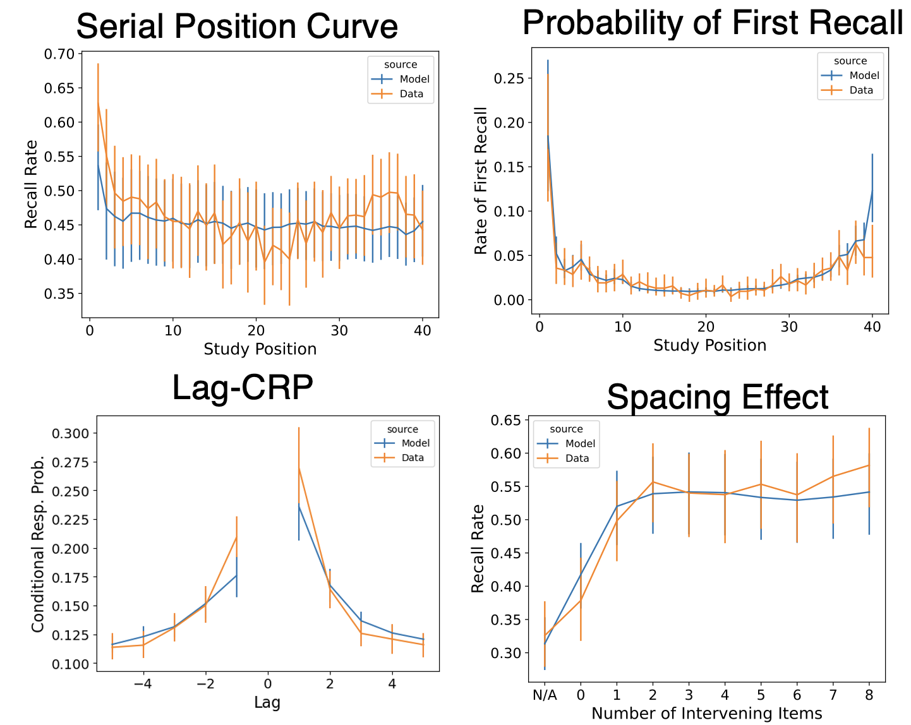

**Simulation of the CMR model fitted to the @lohnas2014retrieved dataset**. The CMR model was fit to the mixed list condition of the @lohnas2014retrieved dataset using the likelihood-based fitting technique. The model broadly accounted for benchmark temporal organizational phenomena (primacy effect, recency effect, lag-contiguity effect) as well as the spacing effect.
:::

Previous analyses of the @lohnas2014retrieved and @kahana2005spacing archival datasets substantially inform expectations and provide motivating questions for the proposed experiment.
Following the methodology described above, we fit the CMR model to each dataset and simulated both benchmark and repetition effects analyses.
Matching with results from @lohnas2014retrieved, CMR successfully accounted for the spacing effect in the @lohnas2014retrieved dataset, with the probability of recall increasing with increasing spacing between repeated items.
The model also reproduced outcomes of the repetition neighbor contiguity analysis, showing a robust boost in transition rates between neighbors of repeated items relative to control lists, consistent with the hypothesis that encoding the second presentation of an item retrieves and reinstates the context of the first presentation, influencing the context of subsequent study events.
The model also broadly accounted for outcomes of the lag-CRP and serial position effect analysis, showing a preference for transitions to temporally adjacent items and a U-shaped serial position curve reflecting the primacy and recency effects (@fig-repeat-preliminary-fits).

However, the model could not account for outcomes of the repetition lag-CRP analysis, which revealed a differential repetition contiguity effect in both the @lohnas2014retrieved and @kahana2005spacing datasets.
In both datasets, participants reliably showed a preference for transitioning to items studied near the first presentation of a repeated item relative to the second.
To measure the proportion of transitions expected in the absence of repeated items, using just the @lohnas2014retrieved dataset we match the serial positions used in the mixed lists to corresponding items in the control lists, shuffling assignment 100 times. 
The effect disappeared under this control analysis.
Applying our proposed statistical testing to the control-corrected +1 transition rates relative to each repetition index, we find that the difference in transition rates is statistically significant (t=3.704; p=0004), suggesting that the differential repetition contiguity effect is meaningful and not due to serial position effects.
Applying the same statistical test to the @kahana2005spacing dataset without controlling for serial position effects (because control list data is not available), we find that the difference in transition rates is also statistically significant (t=2.909; p=0.0025), suggesting that the differential repetition contiguity effect is robust across datasets.

When we apply the same analyses and statistical tests to data simulated from the CMR model after fitting to the @lohnas2014retrieved dataset, we find that the model does not predict the differential repetition contiguity effect beyond that accounted for by our control analysis for serial position effects.
Instead, the model predicts that participants should transition to items studied near the second presentation of a repeated item at roughly the same rate as to items studied near the first presentation -- t=1.07; p=0.1456 for @lohnas2014retrieved, and t=0.93; p=0.1771 for @kahana2005spacing.
This suggests that the model may not be able to account for the differential repetition contiguity effect, even after fitting to data that exhibit the effect.
These results together suggest that the differential repetition contiguity effect may reflect a more complex interaction between initial and secondary study events for repeated items that is not directly captured by CMR or addressed by other analyses of repetition effects in free recall.

::: {#fig-repeat-rep-crp layout="[[1, 1], [1, 1], [1, 1]]"}

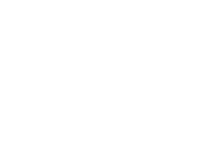

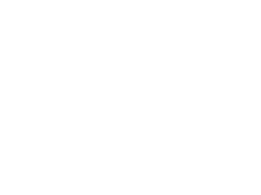

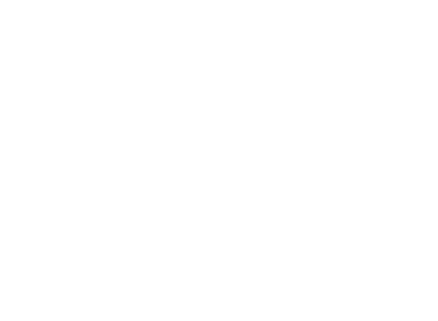

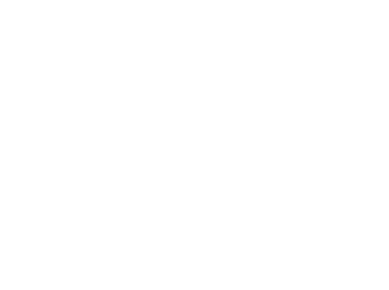

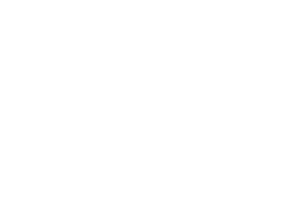

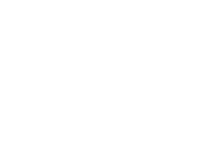

Simulation of repetition lag-CRP analysis and control for serial position effects from @lohnas2014retrieved dataset. 
**Top Row**: Main and control (left and right) repetition lag-CRP analysis results for the @lohnas2014retrieved dataset. 
**Middle Row**: Simulated main and control analysis results from the CMR model fitted to the @lohnas2014retrieved dataset.
**Bottom Row**: Observed and simulated (left and right) analysis results for the @kahana2005spacing dataset.
:::

We expect that the proposed experiment will replicate the differential repetition contiguity effect observed in the archival datasets in the new experimental data.
We further expect CMR to continue to struggle to account for the differential repetition contiguity effect, even after fitting parameters directly to applicable data.
On the other hand, we expect CMR's ability to account for other repetition and benchmark effects to be robust, as it has been in prior evaluations.
These outcomes would validate the need for alternative models that integrate other accounts of repetition effects and allow examination of how our proposed experimental manipulations affect the strength of the effect and potentially elucidate its underlying causes.

***

### Manipulation of Initial Position of Repeated Items: Testing the Deficient Processing Hypothesis

Our experimental manipulation of the initial position of the first presentation of repeated items directly addresses a particularly intuitive hypothesis about the causes of the differential repetition contiguity effect.
According to the deficient processing hypothesis, when items are repeated, the encoding of the second presentation of the item is less detailed than the first, leading to a weaker memory trace and less effective retrieval cues [@greene1989spacing; @maddox2016understanding].
The most detailed specification of this hypothesis is that the strength of memory traces associated with repeated items is inversely proportional to the lag between their presentations, explaining the spacing effect in free recall using mechanisms entirely distinct from those proposed by CMR.
A range of mechanisms for this deficiency have been proposed, including reduced allocation of attentional resources, interference from the first presentation, and a lack of novelty in the second presentation [@murdock1961retention].
Following this hypothesis, the differential repetition contiguity effect may be driven by differences in the accessibility of memory traces associated with repeated items.
The second presentation of a repeated item may be less effectively encoded than the first, making it less influential in the course of memory search when a repeated item is recalled.

Our manipulation of the initial position of the first presentation of repeated items uses the primacy and recency effects to examine this hypothesis by examining how the strength of the repetition contiguity effect changes with the primacy and recency effects.
Importantly, though we manipulate the influence of primacy and recency effects on the encoding of repeated items, our hypothesis is not primacy and recency effects explain the differential repetition contiguity effect.
Instead, we seek to explore whether differences in the strength of memory traces associated with repeated items can influence the effect, identifying a mechanism relevant to its structure.
A deficient processing account of differential repetition contiguity would predict that the effect will be most pronounced when the initial position of the first presentation of a repeated item occurs at the beginning of a study list due to interaction with the primacy effect.
It would further predict that the effect is weakest when the second presentation of a repeated item occurs near the end of a study list.

If our experiment observes these patterns, these results might motivate an extension of retrieved context theory and the CMR model that incorporates the deficient processing account of repetition effects in memory.
Since deficient encoding would only be engaged when items are repeated, such a mechanism could account for the differential repetition contiguity effect in mixed list trials without affecting simulations of control list data and allow for a more complete account of repetition effects in free recall.
Speculating about the possibility that CMR may require further refinement to account for repetition effects in memory, @lohnas2014retrieved suggested a way it could integrate the deficient-processing theory of the spacing effect into its existing framework.
Its proposal in the literature highlights its intuitive appeal and makes it deserving of further investigation.
The authors propose adding deficient processing by having the amount of context retrieved for a repeated item decreases as a function of its lag/spacing.

In a more detailed proposed, @collins2020minerva presented MINERVA-DE, an extension of the classic MINERVA 2 model [@hintzman1984minerva], that integrates a deficient-processing mechanism into the instance-based model to account for spacing and repetition effects in recognition memory.
MINERVA-DE conceptualizes deficient-processing as an attentional artifact, driven by "temporary, familiarity-mediated shifts in exogenous attention that bias attention toward unfamiliar, not-repeated words and away from familiar, repeated words".
In MINERVA-DE, a short-term memory store called primary memory is maintained with a long-term secondary memory.
When a word is attended, its familiarity is computed relative to the items in primary memory.
The more familiar a studied item is to existing items in primary memory, the less well it is encoded in secondary memory.
This process is called discrepancy encoding, because encoding is strongest for items that are discrepant with information already stored in primary memory.
CMR already has an attention process mediating learning rates; @sederberg2008context proposes one to enforce the primacy effect, scaling the amount of learning based on the serial position of the studied item according to:

$$
\Delta M^{CF}_{exp} = \phi_i f_i c^{'}_i
$$

I tried adding another mechanism that similarly scales the amount of learning based on the "familiarity" of the encoded item, calculated on the basis of (cosine) similarity to the current state of $C$.
A familiarity_scale parameter $\zeta_s$ would control the amount of this scaling, similar to $\phi_s$:

$$
\zeta_i = (1 - S(f_i, c_i))^{\zeta_s}
$$

Configured this way, when $\zeta_s$ is 0, the effect of familiarity on learning will be nil, but as it grows, that effect will increase.

A range of options exist for including such a mechanism in the CMR model.
During encoding of the second presentation of an item in a list, this mechanism could be applied selectively to variable scale learning of feature-to-context associations, learning of context-to-feature associations, the amount of context retrieved during recall, the amount of context associated with the item reinstated during encoding, or a combination of these.
Furthermore, a simpler version of the mechanism could, instead of scaling processing deficiency as a function of lag, apply a fixed reduction in the encoding quality of successive presentations of an item.
By evaluating a range of candidate models that integrate deficient processing into the CMR model, we can identify the most effective and parsimonious account of repetition effects in free recall and provide a more detailed and specific characterization of the structure of memory for repeated experience.

While this approach to account for the differential repetition contiguity effect and other repetition effects in free recall has intuitive appeal, there are reasons to suspect that it may not be supported by our data and in model evaluation.
First, diminished encoding of the second presentation of a repeated item potentially fails to address or even directly works against other known repetition effects in memory.
In particular, the deficient encoding hypothesis weakens the basic repetition effect, which predicts that the probability of recall increases with the number of times an item is presented.
Furthermore, the deficient encoding hypothesis may not be consistent with the superadditivity of repetition in free recall, where the probability of recall for a repeated item with spaced presentations is greater than the sum of the probabilities of recall for either of two distinct items presented in the same positions [@maddox2016understanding].
Proposed deficient encoding mechanisms specifically interfere with processing of item repetitions in seeming direct opposition to this phenomenon.
Implemented within the CMR model, the tension between the need to account for the differential repetition contiguity effect and the need to account for other repetition effects in memory may require a more complex and nuanced account of repetition effects in memory.
This gap in the deficient processing hypothesis is a common challenge in the literature, and our experiment will contribute to the ongoing effort to resolve it [@maddox2016understanding].

In addition, my preliminary simulations of model extensions discussed here further suggest this mechanism, despite support in the broader literature [@greene1989spacing; @collins2020minerva], poorly accounts for applicable empirical constraints in free recall for lists with repeated items.
In proposed variants manipulating contextual reinstatement for example, deficient encoding of an item presentation in a way that affects the evolution of context during the study phase of a list learning experiment can diminish the ability for an item's recall to cue the recall of nearby items by disrupting the strength of association between study contexts.

On the other hand, proposed variants that ultimately work to manipulate the extent to which the study context associated with an item's first presentation is reinstated upon recall of the item relative to its second presentation may not be a sufficiently strong lever to drive the differential repetition contiguity effect.
The reason why is that study contexts associated with the first and second presentations of a repeated item are not especially different from one another. 
Both study events for a twice-presented item reinstate the item's pre-experimental contextual associations. 
The second study event for a repeated item additionally reinstates the context of the first study event, but this only serves to enhance the similarity of the contextual states to be associated with the item in the memory traces for each of the item's presentations.
Consequently, manipulations of CMR's simulation to exclusively reinstate the study context of a repeated item's first presentation upon recall of the item have not been successful in supporting a large difference in the probability of transitioning to neighbors of the item's first presentation compared to neighbors of the item's second presentation.

::: {#fig-repeat-deficient-processing layout="[[1], [1]]"}

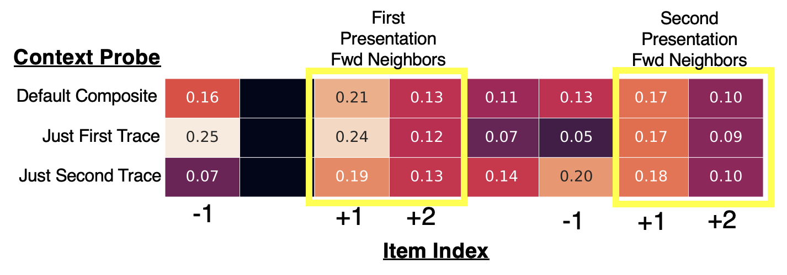

**Predicted transition rate as a function of context cue given arbitrary subject's parameters.** 
Many proposed implementations of deficient processing and study phase accounts of repetition effects traditionally explain phenomena such as the spacing effect in terms of diminished access at retrieval to the context associated with the second presentation of a repeated item relative to the first.
However, driving retrieval with either trace's context does not substantially bias transitions to either presentation’s +1 or +2 neighbors compared using a composite of both contexts.
This suggests that trace dominance in memory search may not be a strong lever for explaining the differential repetition contiguity effect.
:::

This issue could potentially defeat a broad class of potential mechanisms that emphasize an asymmetry in how study contexts are reinstated upon recall of repeated items to explain the differential repetition contiguity effect.
Other mechanisms in this class could include those that selectively strengthen the association between a repeated item and its first presentation context during the second presentation of the item, or retrieval-oriented mechanisms that select individual memory traces for reinstatement based on their similarity to the current context state.
In the proposed research, I will develop these simulations to demonstrate why this intuitive approach to account for the differential repetition contiguity effect may be substantilally flawed.

### Revisiting How CMR Implements Study-Phase Retrieval

::: {#fig-repeat-reduced-cmr layout="[[1, 1]]"}

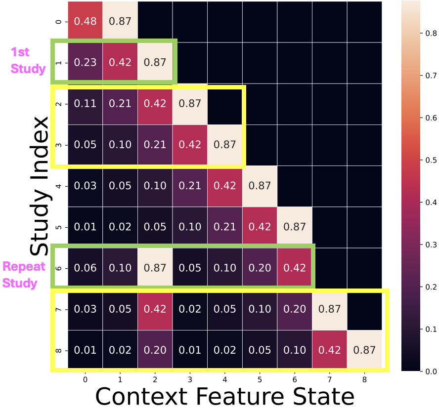{#fig-repeat-full-cmr}

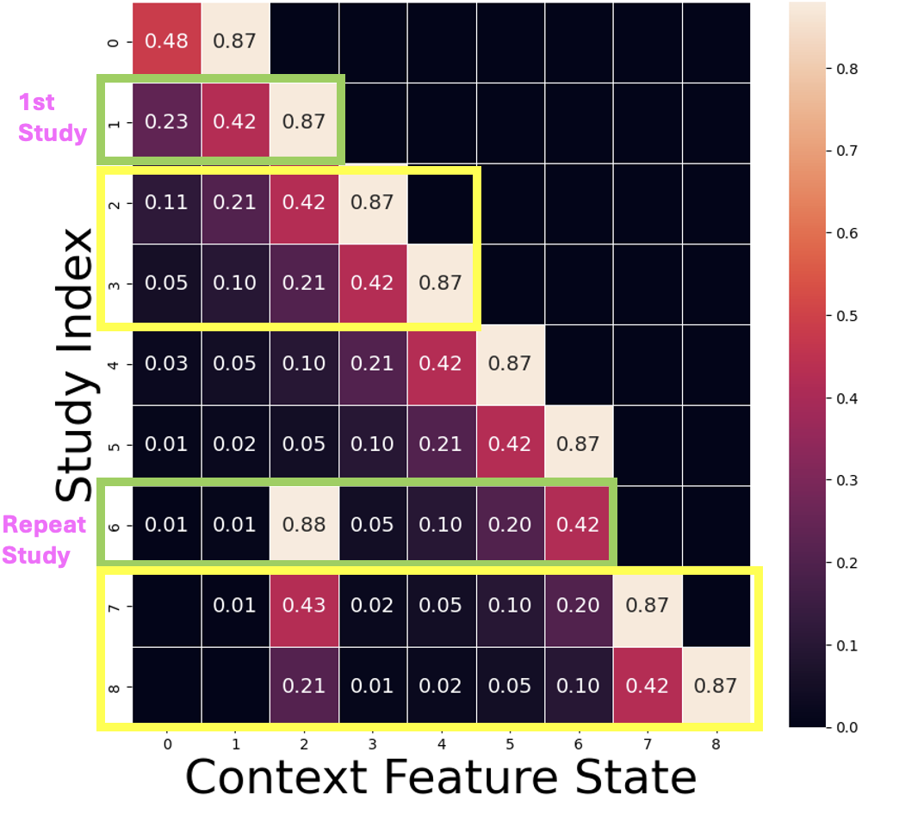{#fig-repeat-reduced-cmr-panel}

Comparison of contextual states during encoding of a list with a repeated item in the full and reduced CMR models. **A**. When a repeated item is presented for the second time, the full CMR model reinstates the context of the item's first presentation along with its pre-experimental contextual associations. **B**. In the reduced CMR model, only pre-experimental contextual associations are reinstated upon encoding of the second presentation of a repeated item. In either model, since pre-experimental contextual associations are reinstated upon encoding of either presentation, +1/+2 neighbors of either presentation (study indices 2/3 and 7/8) exhibit similar contextual states. This similarity is only marginally affected by reinstatement of first-presentation context during the second presentation of the item in the full model.
:::

The study-phase retrieval hypothesis represents another influential account of repetition effects in free recall that could potentially explain the differential repetition contiguity effect.
In its general form, the study-phase retrieval hypothesis posits that studying an item for a second time may trigger retrieval of the first presentation of the item, facilating memory for the item [@maddox2016understanding].
Initial proposals of the study-phase reinstatement mechanism argued that retrieval of an item's prior presentations were necessary to support the spacing effect in memory tasks [@hintzman1974theoretical].
Other work, including the CMR model, gives the mechanism a complementary role in explaining repetition effects in free recall [@lohnas2014retrieved; @maddox2016understanding].
In particular, by specifying an interaction between traces of the first and second presentations of a repeated item that does not occur for distinct items, the study-phase retrieval is argued to help explain the superadditivity of item repetitions -- the phenomenon where spacing effects are more pronounced for repeated items than for distinct items in the same study positions in study lists.
A study-phase retrieval mechanism could also explain the differential repetition contiguity effect by suggesting that retrieval of the first presentation of a repeated item upon encoding its second presentation might bias memory for repeated items toward neighbors of the first presentation.

The CMR model's context reinstatement mechanism already implements a form study-phase retrieval, where the context associated with an item's first presentation is reinstated during the second presentation of the item.
This mechanism is argued to support both the model's ability to account for the spacing effect, the superadditive advantage of item repetition in free recall, and the repetition neighbor contiguity effect in free recall [@lohnas2014retrieved].
Given these successes, it is perplexing that the model does not predict a differential repetition contiguity effect in free recall, as observed in the @lohnas2014retrieved and @kahana2005spacing datasets.
But a portion of my preliminary research has focused on re-examining how CMR implements the contextual reinstatement retrieval mechanism argued to underlie key repetition effects in free recall [@lohnas2014retrieved], interpret why it does not contribute to a differential repetition contiguity effect, and consider whether the mechanism deserves revision. 
Strikingly, this research has called into question whether CMR's implementation of study-phase retrieval contributes at all to its ability to explain any repetition effects in free recall discussed in this proposal.

To investigate the mechanism, we can implement a variant of the CMR model that does not include the study-phase retrieval mechanism and compare its performance to the full model.
In the reduced variant, when an item is presented for a second time, rather than reinstate the context of the first presentation of the item along with its pre-experimental contextual associations, only pre-experimental contextual associations are reinstated -- the same as when the item is presented for the first time.
This variant can then be fitted to the @lohnas2014retrieved dataset and evaluated using the likelihood-based model comparison and simulation of applicable repetition and benchmark effect analyses.
We can also perform focused analyses of the internal states of the model after simulation of study lists to measure how the model's implementation of study-phase retrieval affects associations between repeated items and their neighbors.

In preliminary simulations of the reduced CMR model, we find that the model accounts for performance on the @lohnas2014retrieved dataset comparably to the full model.
Average log-likelihoods assigned to the dataset by the reduced model are indistinguishable from those assigned by the full model and the model's ability to account for repetition and benchmark effects in free recall is largely unchanged.
These outcomes suggest that the study-phase retrieval mechanism does not substantially contribute to the model's ability to account for the data.

The most striking result of this research is that the reduced CMR model successfully accounts for outcomes of the repetition neighbor contiguity analysis initially proposed by @lohnas2014retrieved specifically to test CMR's implementation of study-phase retrieval.
According to the premise of the analysis, reinstatement of first presentation context during the second presentation of a repeated item should enhance the similarity of contextual states associated with neighbors of each presentation of the item, driving a boost in transition rates between neighbors of repeated items relative to control lists.
However, reinstatement of pre-experimental context alone upon encoding of either presentation already enforces this pattern of similarity between neighbors of repeated items, with the addition similarity contributed by reinstatement of first-presentation context during the second presentation of the item only marginally affecting the outcome by comparison.

Similarly, CMR's implementation of study phase reinstatement does not clearly improve the model's ability to account for the spacing effect in free recall.
While preliminary analyses so far do not evaluate either CMR or its reduced variant's simulation of recall rates for spaced distinct items (using the OR score analysis described above), the model's ability to account for the spacing effect in free recall after parameter fitting is not substantially affected by the presence or absence of the study-phase retrieval mechanism.
The effect of excluding the mechanism on simulation of the differential repetition contiguity effect is also minimal.
Indeed, by enhancing the similarity between first and second presentation study contexts associated with repeated items, the study-phase retrieval mechanism may actually disrupt the model's ability to account for the differential repetition contiguity effect by reducing the ability of the model to selectively target neighbors of the first presentation of a repeated item upon recall of the item.
The proposed research will seek to confirm these results and provide a more detailed and specific characterization of CMR's mechanisms for encoding and retrieval of repeated items.

The CMR model's current implementation of study-phase retrieval effectively works to associate the context of a repeated item's first presentation with that the item's second presentation, but does not clearly contribute to the basic repetition effect or the kind of dominance of first-presentation context during retrieval that would support a differential repetition contiguity effect.
An alternative mechanism could be supposed that targets for directly strengthening initial presentation memory traces during the second presentation of a repeated item.
Compared to the deficient processing hypothesis, this mechanism would similarly support the superadditivity of item repetitions in free recall.
At the same time, it would sidestep the need to reduce the encoding quality of the second presentation of a repeated item, potentially avoiding conflicts with other repetition effects in memory that focus on its mnemonic advantages over encoding of distinct items.
However,depending on its implementation, since contextual states associated with the first and second presentations of a repeated item would still be similar, this mechanism could still struggle to account for the differential repetition contiguity effect for the same reasons that a second-presentation deficient processing mechanism might.
A strategy for avoiding this issue could ignore modification of trace accessibility during context reinstatement enacted during free recall (involving modifications to the evolution of context during encoding or to learned item-to-context associations), and instead focus on the strength of associations between repeated items and their neighbors during encoding.
New data will help constrain possible mechanisms for study-phase retrieval in the CMR model and identify potential modifications that could better account for differential repetition lag-contiguity in interaction with other repetition and temporal organization effects in free recall.

### Exploring the Compound Cueing Hypothesis

::: {#fig-repeat-backrepcrp}

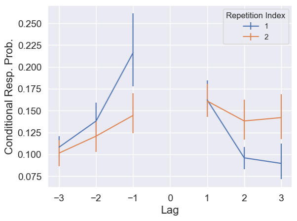{height=200}

**Reverse repetition lag-CRP analysis results for the mixed list condition of the @lohnas2014retrieved dataset.** The specification of the analysis involves shifting the repetition lag-CRP analysis to consider transitions TO recalls of repeated items, rather than transitions FROM recalls of repeated items.
Lags between the recalled item and the item that was recalled immediately before it are tabulated, and the lag-CRP is calculated as before, one centered on the first presentation of repeated items and one centered on the second presentation of repeated items.
Analysis outcomes suggest that recalls of repeated items tend to be preceded by recalls of items studied near the first presentation of the repeated item, potentially supporting the differential repetition contiguity effect in successive transitions from repeated items.
:::

Another attractive account of the differential repetition contiguity effect focuses on the possibility that items recalled before recalls of repeater items bias the following recall transition toward neighbors of the first presentation of the repeated item.
CMR posits that temporal context changes gradually, only partially replacing its previous state with context reinstated from the current item.
This implies that context reinstated from retrieval of an item can have persistent influence beyond the first successive retrieval event [@lohnas2014compound].
If recalls of repeated items tend to be preceded by recalls of items that were studied near the first presentation of the repeated item, this could bias the recall transition toward neighbors of the first presentation of the repeated item and explain the effect.

A few preliminary results make this account attractive.
First, an important result of applying our *reverse* variant of the repetition lag-CRP analysis to archival datasets was the discovery that recalls of repeated items do indeed tend to be preceded by recalls of items that were studied near the first presentation of the repeated item (@fig-repeat-backrepcrp).
Second, our initial fits of the CMR model to the @lohnas2014retrieved dataset suggest that along with failing to predict a differential repetition contiguity effect in our repetition lag-CRP analysis, the model also simulates overly flat lag-contiguity effects (@fig-repeat-preliminary-fits) across responses in both control and mixed list conditions when applying our regular lag-CRP analysis. 
This suggests that the model may be underpredicting the frequency of +1 transitions across the dataset, reducing occurrences of compound cueing effects that would bias transitions toward neighbors of the first presentation of repeated items.
This observation potentially explains CMR's failure to predict a differential repetition contiguity effect in terms of its failure to accurately account for the data's substantial lag-contiguity effects.
Manually increasing parameters in CMR responsible for the strength of the lag-contiguity effect do indeed also create a substantial differential repetition contiguity effect, but at the cost of disrupting other benchmarks and overall model fit.

These preliminary results indicate that CMR is systematically underpredicting the strength of temporal organization, even in trials without item repetitions.
The compound cueing hypothesis provides an account for why such systematic underprediction could cause the CMR model to fail to predict the differential repetition contiguity effect by limiting the extend to which persistent context from prior recalls can bias transitions from repeated items toward neighbors of their first presentation.
To investigate this possibility, we will explore strategies to diagnose gaps in preliminary fits of the CMR model to the @lohnas2014retrieved dataset and develop new fits that better account for the data's substantial lag-contiguity effects.
This work will help clarify the role of compound cueing in the differential repetition contiguity effect and allow fuller arbitration between all hypotheses considered here with greater confidence.

## Conclusion

This study examines how the lag-contiguity effect -- the tendency for items positioned close together in a study list to be retrieved successively during free recall [@kahana1996associative] -- manifests for items with multiple study positions.
The lag-contiguity effect has informed a conceptualization of memory search in the free recall task as a traversal over a mental timeline of events, with transitions between items reflecting the temporal proximity of their study positions.
However, this notion is disrupted when considering transitions from items with multiple study positions, which have multiple positions on a hypothetical mental timeline.
Given the central role of the lag-contiguity effect in theories of memory search [@howard2002distributed; @polyn2009context; @kahana2020computational], understanding how it manifests for recalls of repeated items is crucial for refining our understanding of memory for repeated experience.

In the broader context of my thesis, the proposed research will contribute to understanding of how sequence learning and memory depends on content-based relationships between items in the sequence.
Other proposed research examines the same question where content relationships are provided by semantic similarity and narrative structure.
These constructs are comparatively complex and abstract next to the simple repetition relationships considered in the current proposed research, and require addressing more complex questions about how applicable relations are perceived in represented in memory.
A robust account of repetition effects in free recall could help ground such research in a more fundamental understanding of how memory for sequences is structured and help advance toward a unified account that addresses both simple and complex relationships between items in a sequence.

